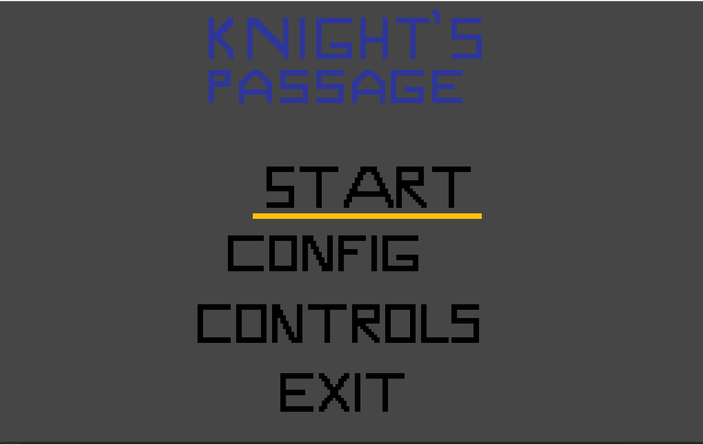
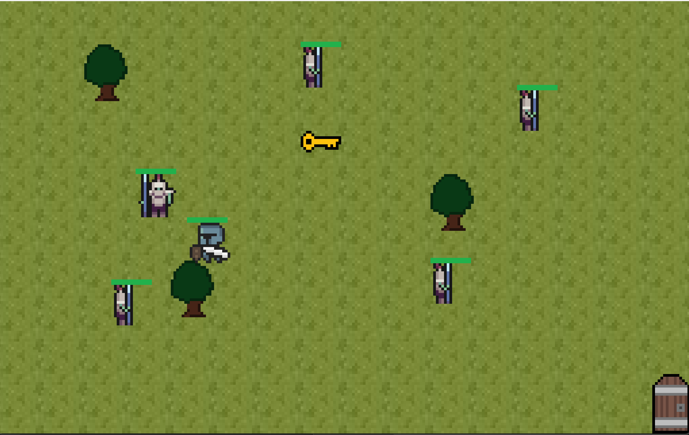
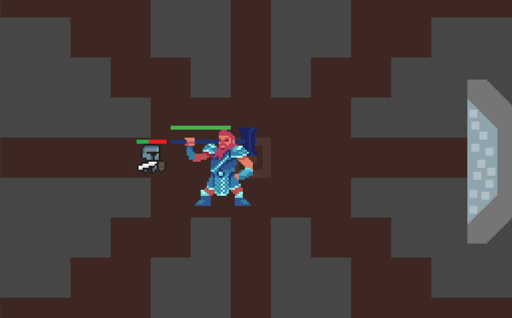
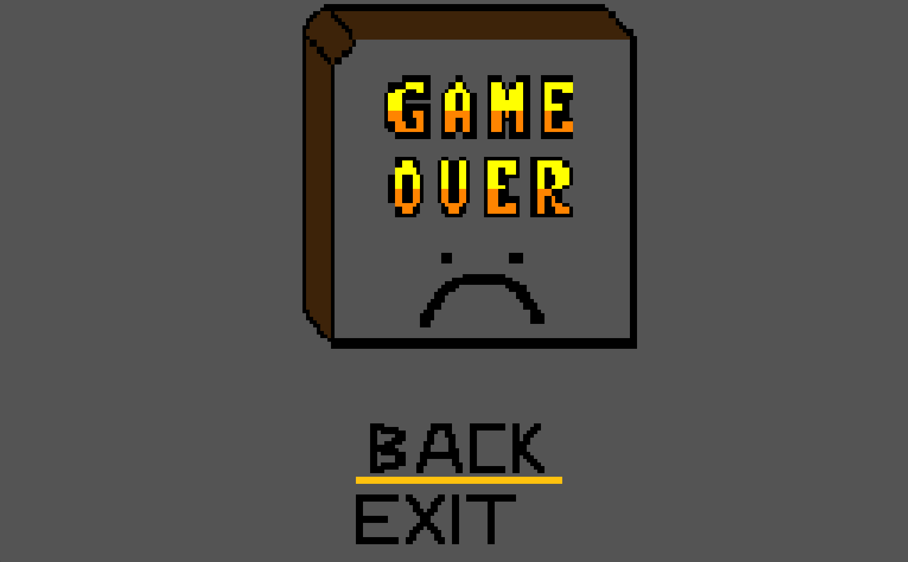
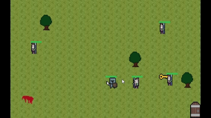

# LDTS_T02G09 - Knights Passage

## Game Description

In this thrilling game you can guide the player through multiple levels, collecting keys and avoiding or defeating enemies to reach the exit. 
Each level features unique arenas with walls, trees, and other obstacles, and the game offers multiple difficulty settings.

This project was developed by José Maio (up202404872@up.pt) and Pedro Vilaça (up202404967@up.pt) for LDTS 2025⁄26.

For a more detailed version of this description click [here](./docs/README.md).

## Game Screenshots

  

  <b><i>Fig 1. Start Menu</i></b>

  

  

  <b><i>Fig 2. Level 1</i></b>

  

  

  <b><i>Fig 3. Boss Level</i></b>

 

  

  <b><i>Fig 4. Game Over (Loss)</i></b>

 

  

  <b><i>Gif 1. Gameplay</i></b>

 

    