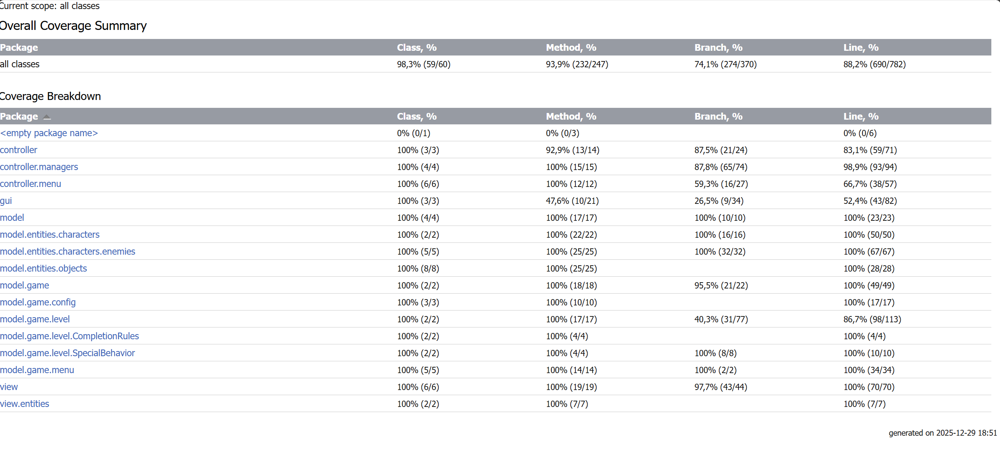

## LDTS_T02G09 - Knights Passage

In this thrilling game you can guide the player through multiple levels, collecting keys and avoiding or defeating enemies to reach the exit. 
Each level features unique arenas with walls, trees, and other obstacles, and the game offers multiple difficulty settings.

This project was developed by José Maio (up202404872@up.pt) and Pedro Vilaça (up202404967@up.pt) for LDTS 2025⁄26.

### IMPLEMENTED FEATURES

- **Multiple Levels** - The player can progress into the next level when collects a key or when kills all enemies.
- **Various Game Configurations** - The game difficulty changes depending on the configuration set (enemies are stronger and have more hp).
- **Attacking Enemies** - The game character is able to damage enemies when close to them.
- **Getting Hidden Keys** - In certain levels keys will stay hidden until the player eliminates all existing enemies.
- **Starting Menu** - The game will include a starting menu that will allow the user to choose the configuration/difficulty settings for the game.
- **Basic Enemy Moving Algorithm** - The enemies will follow a strict algorithm, making them always move closer to the player.
- **Hitboxes** - The player and enemies will collide witth objects, based on fixed hitboxes.

### Planned Features

All the planned features were successfully implemented.
### DESIGN

#### THE LEVELS SHOULD NOT BE CREATED BY THE GAME CLASS

**Problem in Context**

A major challenge in the project was the complexity of building levels, arenas, and all their elements (enemies, walls, keys, spawn positions, exit positions…).
At first, this logic was grouped in the Game class, making it and its constructor huge, even for just one level.
This caused the Game class to have too many responsabilities, violating the Single Responsability Pattern.

**The Pattern**

To solve this problem we applied the **Factory Method** pattern. This pattern allows us to centralize level objects creation in a single class that will have

**Implementation**

  

  <b><i>Fig 1. Factory Method screenshot</i></b>

    

This class can be found in the following file:

- [LevelFactory](../src/main/java/model/game/level/LevelFactory.java).

**Consequences**

The use of the Factory Method Pattern in the current design allows the following benefits:

- Centralizes complex level creation logic, as all level construction rules are in a single class.
- Supports scalability as adding a new level is as simple as creating a new method, for example createLevel5().
- Cleaner and more maintainable code because Game goes back to only managing gameplay flow and not constructing complex objects.

#### ARCHITECTURAL PATTERN
**Problem in Context**

Mixing game logic, user interface code, and data structures makes the code hard to maintain and test. Changes in the UI shouldn't break game rules, and vice-versa.

**The Pattern**

We applied the **Model-View-Controller (MVC)** pattern. This architectural pattern separates the application into three main components:
*   **Model**: Represents the data and business logic (e.g., `Game`, `Level`, `Element`).
*   **View**: Handles the display and user interface (e.g., `GameView`, `LanternaGui`).
*   **Controller**: Manage user input and updates the model (e.g., `GameController`, `MenuController`).

**Implementation**

The main components can be found in:

- **Model**: [model](../src/main/java/model)
- **View**: [view](../src/main/java/view), [gui](../src/main/java/gui)
- **Controller**: [controller](../src/main/java/controller)

**Consequences**
- Improved code organization and separation of concerns.
- Easier to modification (e.g., changing the UI library wouldn't affect the Game logic).
- Facilitates parallel development of logic and UI.

#### GAME LOOP
**Problem in Context**

The game needs to process input, update its state, and render frames continuously, but doing this without control can lead to inconsistencies (game running too fast on powerful machines) or freezing while waiting for input.

**The Pattern**

We implemented the **Game Loop** pattern. This pattern decouples the progression of game time from user input and processor speed.

**Implementation**

The Game Loop is implemented in:

- [GameLoop](../src/main/java/controller/GameLoop.java)

**Consequences**
- Smooth and consistent gameplay experience across different hardware.
- Clear separation between the update phase and the render phase.

#### TEMPLATE METHOD
**Problem in Context**

We have different types of menus (Start, Settings, Controls) that all follow the same basic lifecycle: they need to be displayed, handle navigation input, and then perform a specific action when an option is selected.

**The Pattern**

We applied the **Template Method** pattern in the `AbstractMenuController`. This abstract class defines the "skeleton" of the control flow (the `start()` method loops rendering and input handling) but lets subclasses implement the specific steps (like `update()` or specific menu actions).

**Implementation**

This pattern is applied in:

- [AbstractMenuController](../src/main/java/controller/menu/AbstractMenuController.java) (Abstract Class)

**Consequences**
- Reduces code duplication across different menu controllers.
- Enforces a consistent behavior structure for all menus.

#### FACADE 
**Problem in Context**

The project uses the Lanterna library for text-based graphics. Lanterna's API is powerful but raw/low-level. Scattering Lanterna-specific code throughout the game logic would make it tightly coupled to this specific library and harder to use.

**The Pattern**

We used the **Facade**  pattern in the `LanternaGui` class. This class provides a simplified, domain-specific interface (`drawImage`, `clear`, `refresh`) that the rest of the game uses, hiding the complexity of the underlying Lanterna library.

**Implementation**

The Facade is implemented in:

- [Gui](../src/main/java/gui/Gui.java)
- [LanternaGui](../src/main/java/gui/LanternaGui.java)

**Consequences**
- Decouples the game logic from the specific GUI library.
- Provides a simpler, cleaner API for the views to use.

#### STATE
**Problem in Context**

The application behaves very differently depending on whether the user is in the Main Menu, playing the Game, or on the Game Over screen. Handling all this logic with big `if-else` blocks would be messy.

**The Pattern**

We utilized a **State**-like pattern by having different Controller classes (`StartMenuController`, `GameController`, `GameOverMenuController`) representing the different states of the application. The main application flow switches between these controllers.

**Implementation**

The states are represented by the controllers:

- [Controller](../src/main/java/controller/Controller.java) (Interface)
- [GameController](../src/main/java/controller/GameController.java)
- [StartMenuController](../src/main/java/controller/menu/StartMenuController.java)
- [GameOverMenuController](../src/main/java/controller/menu/GameOverMenuController.java)

**Consequences**
- Each state (menu, game, game over) is isolated in its own class.
- Makes transitions between game states explicit and manageable.

#### STRATEGY 
**Problem in Context**

Different levels have different winning conditions (e.g., "collect key" vs "kill all enemies") and different special behaviors. Hardcoding these rules into the Level class would make it rigid and hard to extend.

**The Pattern**

We applied the **Strategy** pattern for `CompletionRules` and `SpecialBehavior`. The `Level` class delegates these checks to strategy objects, allowing us to swap rules easily.

**Implementation**

The strategies are defined in:

- [CompletionRules](../src/main/java/model/game/level/CompletionRules)
- [SpecialBehavior](../src/main/java/model/game/level/SpecialBehavior)
- [Level](../src/main/java/model/game/level/Level.java) (Context)

**Consequences**
- Adding new game modes or level types is easy (just create a new Rule class).
- Logic for winning/losing is separated from the core Level data.

#### KNOWN CODE SMELLS

Since the last updates made all the previous found code smells have been fixed.
### TESTING

  

  <b><i>Fig 6. Coverage Report</i></b>

- [Mutation Testing](../docs/202512291853/index.html)

### SELF-EVALUATION

- José Maio: 50%
- Pedro Vilaça: 50%
